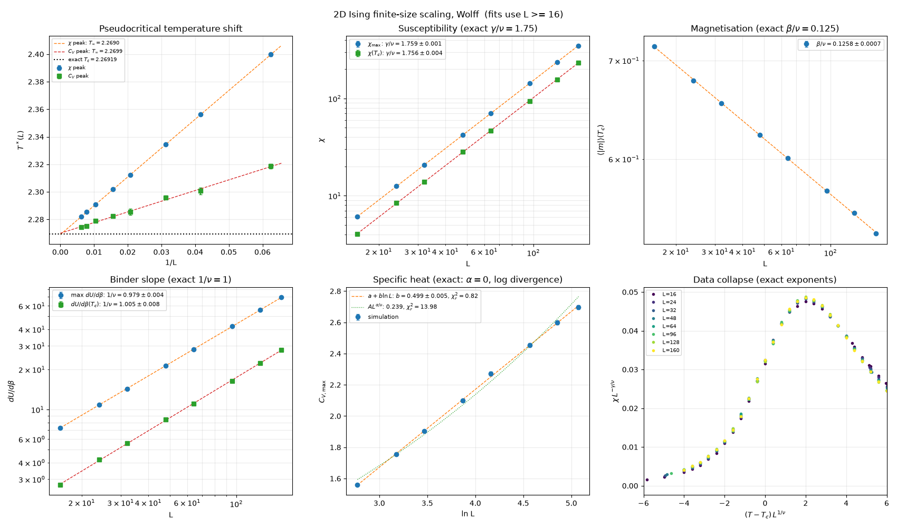
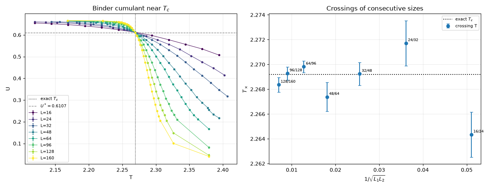
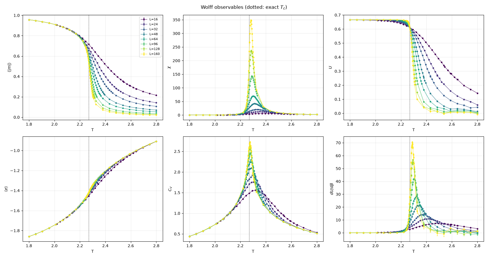
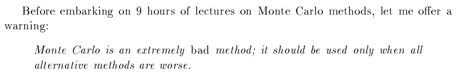

# Markov Chain Monte Carlo Studies of Ising Criticality in Two and Three Dimensions
An ongoing year-long project supervised by Patrick Fritzch, Hitachi Assistant Professor in High Performance Computing. Developing a Monte Carlo framework in C++ and Python to study critical behaviour in the 2D and 3D Ising models, implementing and comparing the Metropolis, Wolff and Swendsen-Wang algorithms. Measuring autocorrelation times and the dynamic exponent <em>z</em> to quantify critical slowing down, and estimate T<sub>c</sub> and the critical exponents using finite-size scaling and Binder cumulants. The 2D case is known exactly, so we validate the implementation against it before extending to 3D.

[Check out the proposal here](pdfs/Proposal.pdf)

# Structure
```
CriticalExponents/               # FSS with wolff sims in cpp
efficient/                       # work on implementint Metropolis and Wolff in cpp
IsingWorkProbablisticComp/       #relevant files from summer work on MCMC
pdfs/                            # final work
Wolff_Algorithm/                 # cluster algorithms study
```

# Current Progress on Exponents
In the 2D Ising Model we want to extract the critical exponents:

```math
\begin{aligned}
&\alpha=0,\qquad\beta=\frac{1}{8},\qquad\gamma=\frac{7}{4},\qquad\nu=1\\
&c_v\sim|t|^{-\alpha},\quad m\sim(-t)^{\beta},\quad\chi\sim|t|^{-\gamma},\quad\xi\sim|t|^{-\nu}
\end{aligned}
```

Using Finite Size Scaling

```math
x = t\,L^{1/\nu} \qquad\qquad T=T_c\left(1+x\,L^{-1/\nu}\right)
```

This gives the finite size scaling (FSS) form,

```math
O(T,L) = L^{\kappa/\nu}\,\tilde O(x)
```

and also extracting $T_c$ from the pseudo-critical temperature shift

```math
T_\chi^\star(L)=T_c+T_c\,x_\chi^\star\,L^{-1/\nu} \qquad\qquad T_{c_v}^\star(L)=T_c+T_c\,x_{c_v}^\star\,L^{-1/\nu}
```

and the Binder cumulant $U(T)$

```math
\begin{aligned}
U &= 1-\frac{\langle m^4\rangle}{3\langle m^2\rangle^2}\\
U(T,L) &= \tilde U(x)
\end{aligned}
```

At $T_c$ ($x=0$), $U(T_c,L) = \tilde U(0)\approx 0.6107$ is the same for all lattice sizes, so the crossing point gives $T_c$ without knowing any other exponents.

Its derivative also gives us $\nu$:

```math
\left.\frac{dU}{d\beta}\right|_{T_c} \propto L^{1/\nu}
```

With these we get

<p align="center">
  
  
  
</p>


### Extras
My favorite introduction to Monte carlo work:

<p align="center">

</p>

thats from Alan Sokal in his introduction to his course on Monte Carlo Methods in Statistical Mechanics.