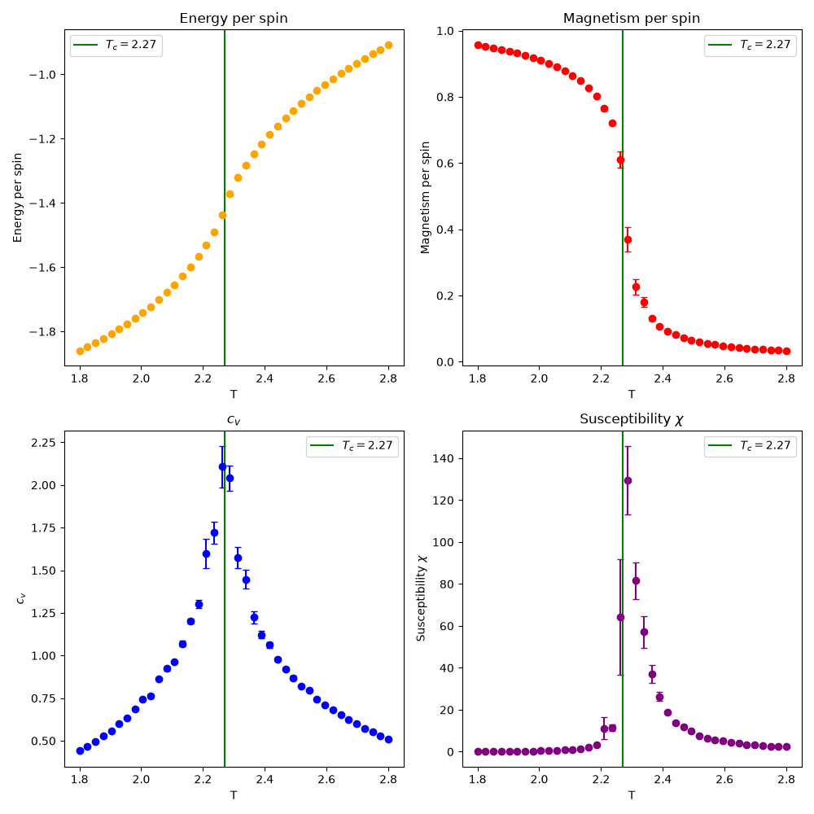
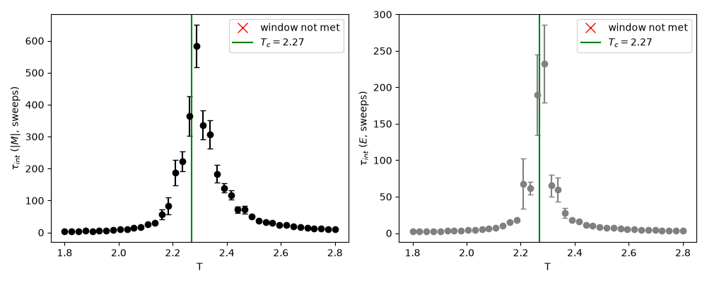
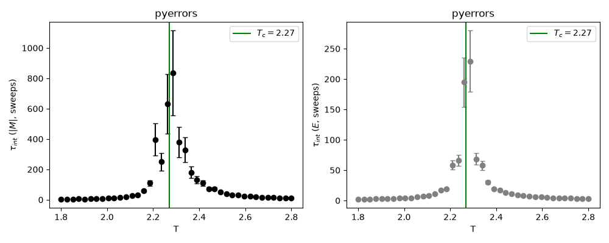

# C++ Implementation

The goal of this section was rewrite my MCMC methods in C++ for <i>speed</i>. We will write the Metropolis and Wolff as [metropolis.cpp](metropolis.cpp) and a Wolff equivalent, which will output data for each full simulation. The data analysis and plotting will then be done in python using similar techniques as in[WolffCriticalV2.py](../Wolff_Algorithm/WolffCriticalV2.py)

# Metropolis
<table>
  
</table>

## auto correlation

<table>

  
  
</table>

### commands
`rm -rf data/met_results/*` clears the data folder
